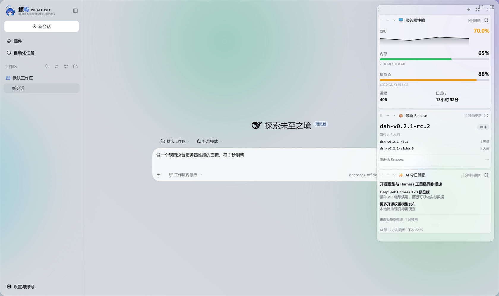
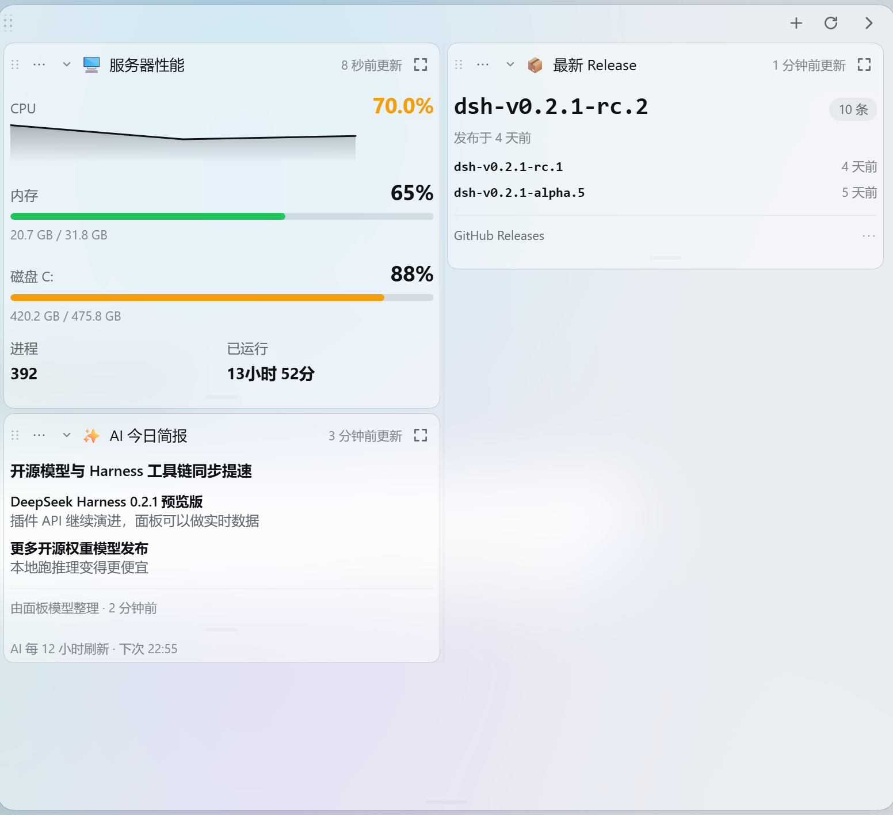
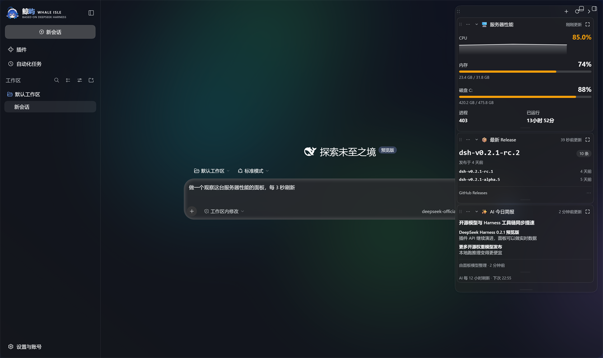
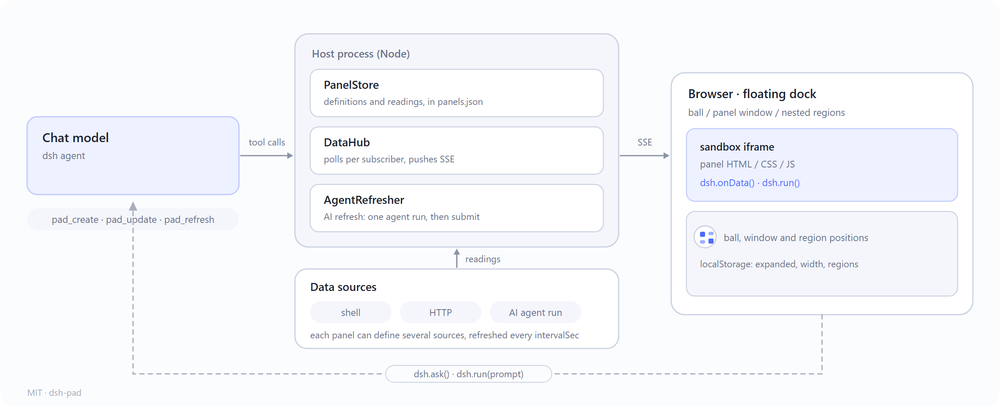

# dsh-pad

[](https://github.com/ChisaAlter/dsh-pad/releases)
[](LICENSE)
[](https://github.com/deepseek-ai/deepseek-harness)

[简体中文](README.md) · **English**

A floating panel plugin for [DeepSeek Harness](https://github.com/deepseek-ai/deepseek-harness) (dsh). Panels are written by the AI in the conversation: “make a panel that watches this server’s performance”, “make a panel that shows my DeepSeek API balance”.

- **Floating ball and free window**: collapsed, it is a draggable floating ball you can put anywhere in the app, and it snaps to the window edges when it gets close; click it to open the panel window. Drag the window’s title bar to place it anywhere, the left edge to set its width, the top or bottom edge to set its height (position and size are remembered in the browser). Sitting against the right edge, on wide screens it still makes room for the conversation, so neither the right-side panel nor the turn-navigation rail is covered.
- **AI-generated**: the model creates and edits panels through the `pad_*` tools. A panel is HTML / CSS / JS running in a sandboxed iframe, and its colors follow dsh’s light / dark theme.
- **Free splitting**: drag a card onto another card’s top / bottom / left / right edge to open a new region there, and keep nesting — two stacked on the left with one large standalone card on the right, for example. Drop on a card’s middle to swap the two cards’ places, drop on empty space in the dock to split it out into a full row. The splitter between the left and right columns can be dragged to set the ratio, with up to 3 cards per row and any number stacked vertically.
- **Automatic update checks**: after startup the plugin checks the latest GitHub Release in the background (every 6 hours by default); the dock header shows a download icon only when a new version is found — click it to update, then restart dsh to apply. A development-directory install is only told about the new version; its sources are never overwritten.
- **Two ways to get data**
  - **Direct data sources**: run a shell command on this machine, or make an HTTP request from it, refreshing at intervals measured in seconds and without spending tokens. Suits API data such as server performance and plan balances.
  - **AI refresh**: run one agent turn in the background on an interval, letting it fetch the data again and submit it. Suits data you can only get through search, reading web pages or multi-step reasoning.
- **Per-panel model**: a button inside a panel can call `dsh.run(prompt)` to run one pass with that panel’s own model and show the result in the card; AI refresh uses the same model.
- **Security**: creating or changing data sources brings up dsh’s own approval prompt (“Allow once / Deny”). If you deny it, the panel keeps an “Allow” button. Secrets are referenced as `{{env:NAME}}`, resolved on the host side only, and never sent to the browser.

The panel design draws on the two kinds of panels in [ChisaBot](https://github.com/ChisaAlter/ChisaBot): sandboxed custom HTML panels, and live panels that a bot refreshes on a schedule.

## Screenshots



Say what you want in the chat and the model builds the card with the `pad_*` tools. The three examples: server performance (a command source refreshing every 3 seconds), the latest release (an HTTP source parsing GitHub’s Atom feed), and an AI daily briefing (AI refresh).



Drop a card on another card’s top / bottom / left / right edge to open a new region there, and keep nesting — two stacked on the left with one large card on the right here. The splitter sets the ratio, with up to 3 cards per row.


Collapsed, the dock is a floating ball you can drag anywhere; it snaps to the window edges, and one click opens the window again.



Card colors follow dsh’s light / dark theme, and the CSS variables inside the iframe switch with it.

## Install

Requires dsh ≥ 0.2.1-rc.2, on the Web UI (`dsh web`) or the Whale Isle desktop app.

The plugin is registered as a **bundle** (written into the profile’s `dsh.profile.bundles`). Do **not** copy the contents of this repository’s `cordis.patch.yml` into the profile’s `cordis.patch.yml` by hand: there is no matching module resolution there, and the whole app will fail to start.

```sh
# self-check first: is lib/ complete, are there leftovers in the profile?
node scripts/doctor.mjs

# from a local directory (while developing)
dsh plugin --profile web add /path/to/dsh-pad

# from GitHub (the repo ships a built lib/, so no build script is needed)
dsh plugin --profile web add github:ChisaAlter/dsh-pad#v0.3.0
```

`lib/index.js` and `lib/client.js` are the only runtime entry points. The repository commits them to git precisely so that installing from GitHub does not depend on build scripts (pnpm refuses to run a dependency’s build scripts by default). If you change the source, run `npm install && npm run build` in the plugin directory first, then install.

Restart `dsh web` / Whale Isle after installing. To uninstall: `dsh plugin --profile web remove dsh-pad`.

## Update

After startup the plugin checks [GitHub Releases](https://github.com/ChisaAlter/dsh-pad/releases) in the background (every 6 hours by default, the first time about 7 seconds after startup). When a new version exists:

1. a download icon appears at the top of the dock (it is not shown when there is no new version);
2. click it to see the current and the new version, then click “Update”;
3. the plugin downloads the built `lib/index.js`, `lib/client.js`, `package.json` and `cordis.patch.yml` from the Release, backing them up to `.dsh-pad-update-backup/` first;
4. restart `dsh web` / Whale Isle for it to take effect.

If the current install is a **development-directory link** (the plugin directory has `.git/`), auto-update only reports the new version and never overwrites source code; run `git pull && npm run build` in the plugin directory instead. “Check again” in the update panel re-checks right away; set `updateCheck: false` to turn off background checks.

### Recovering from a broken install

If Whale Isle or `dsh web` will not start after installing:

1. Open `$DSH_HOME/profiles/web/package.json`, remove `"dsh-pad"` from `dsh.profile.bundles`, and remove `"dsh-pad"` from `dependencies`.
2. Open `$DSH_HOME/profiles/web/cordis.patch.yml` and delete any entry that `insert`s `dsh-pad` (normally it should never appear there).
3. Delete `$DSH_HOME/profiles/web/node_modules/dsh-pad` (it is only a link).
4. Start again.
5. Before installing again, run `node scripts/doctor.mjs`; it tells you straight away whether `lib/` is missing, a link is missing, or the profile patch was written by hand.

## Usage

Just say which panel you want in the conversation:

> Make a panel watching this server’s performance: CPU, memory, disk, load, refreshing every 3 seconds
>
> Make a panel showing my DeepSeek API balance, the key is in the environment variable DEEPSEEK_API_KEY
>
> Make a panel tracking the latest release of deepseek-ai/deepseek-harness, with the AI refreshing it every 6 hours

The **＋** at the top of the dock inserts a prompt — “create a custom panel with `pad_create`” — into the current conversation composer (it is not sent automatically); then write your requirements and send. When a new panel appears, the dock expands and highlights that card automatically.

Each card’s **⋯** menu holds: “Ask AI to change…” (fills the change request into the composer), undo last change, panel model, delete. Click a card title to fold it; a folded panel stops polling.

The **six-dot grip** at the top-left of each card can be dragged onto another card: dropping on the left / right edge splits into two columns, dropping on the top / bottom edge splits into two stacked regions, dropping in the middle swaps the two cards. Regions keep nesting — line up three cards in a row, then drag the middle one onto the bottom edge of the left card, and you get two stacked on the left plus one standalone card on the right.

```text
┌──────────────┬──────────────┐
│ CPU trend    │              │
├──────────────┤  Network IO  │
│ Memory       │              │
└──────────────┴──────────────┘
```

Drop a card on empty space in the dock and it splits out into a full row at the bottom. The vertical splitter between columns can be dragged to set the width ratio of the two neighboring columns; a new panel gets its own row at the bottom.

Each card has a thin bar at the bottom: drag it up or down to set the panel height, double-click to restore auto height; the height is stored per panel in the browser (localStorage) and survives a restart.

The dock itself: drag the title bar to put it anywhere on screen (the position is remembered in the browser), drag the left edge to set the width, drag the top or bottom edge to set its overall height (the panel list scrolls inside, double-click an edge for auto height, and the height is remembered in the browser too). Click the collapse button at the top and the dock becomes a floating ball; drag the ball anywhere with the mouse — it snaps to the window edges when close — and click it to expand again. The **＋** at the top creates a new panel.

`examples/` holds three complete panel definitions (server performance, DeepSeek balance, GitHub release) that you can use as references for model output.

## How a panel works



A panel definition:

```jsonc
{
  "title": "Server performance",
  "icon": "🖥️",
  "html": "…", "css": "…", "script": "…",
  "height": "auto",                    // or a fixed pixel height
  "sources": [                         // direct data sources, may be empty
    { "id": "host", "kind": "command", "command": "…", "parse": "json", "intervalSec": 3 },
    { "id": "bal", "kind": "http", "url": "https://api.deepseek.com/user/balance",
      "headers": { "Authorization": "Bearer {{env:DEEPSEEK_API_KEY}}" }, "parse": "json", "intervalSec": 600 }
  ],
  "model": { "provider": "magpie", "model": "codex/gpt-6.1-sol" },  // optional: the model this panel uses
  "agent": { "instruction": "…", "everyMinutes": 360 }   // optional: AI refresh
}
```

- **Direct data sources** poll only while the dock is expanded and the card is not folded; once the browser is closed or the dock is collapsed to the floating ball, nothing runs on the host anymore. Command output is capped at 512KB, with a default timeout of 10 seconds.
- **Secrets**: `{{env:NAME}}` is resolved from dsh’s credential service first, then from the host process environment variables. Secret values appearing in error messages are replaced with `***`.
- **AI refresh**: the background agent uses dsh’s default model and default agent preset by default (with tools such as web_fetch / web_search), plus exactly two more: `pad_submit_data` and `pad_report_failure`. A panel may carry a top-level `model` (`{ provider, model, reasoningEffort? }`) to pick its own model; without it the global default applies. That model is used for `dsh.run` inside the panel too. “Panel model” in the card’s ⋯ menu switches it directly. It only ever sees the `instruction` and the data submitted last time. A single turn runs for at most 5 minutes (configurable); after a failure it retries after a while, and the reason is shown on the card.
- **Panel scripts** run in an iframe with `sandbox="allow-scripts"`: not same-origin with dsh, CSP `default-src 'none'`, no network, no access to cookies or storage, and no access to the parent page. The only way out is `window.dsh`:

| API | Description |
|---|---|
| `dsh.onData(fn)` | Called immediately when data is available, then again on every update. `data = { sources: { [id]: { ok, value, error, at } }, agent: { value, at } \| null }` |
| `dsh.history(id)` | The last 120 successful readings of that data source (accumulated while the page is open), for trend charts |
| `dsh.refresh()` / `dsh.openUrl(url)` / `dsh.ask(text)` | Refresh now / open a link in a new tab / put a sentence into the conversation composer |
| `dsh.run(prompt, { system? })` | Run one pass with this panel’s model, returning `{ ok, text?, error? }`; plain text generation with no tools or network, handy for a button that processes the current data |
| `dsh.state.get(k)` / `dsh.state.set(k, v)` | Store a small amount of UI state per panel |
| `dsh.fmt.*` | `bytes` `percent` `number` `ago` `time` `duration` |
| `dsh.chart.*` | `sparkline` `bar` `ring`, returning SVG / HTML strings |
| `dsh.tone(x)` / `dsh.escape(s)` | ok / warn / danger colors by threshold / HTML escaping |

`dsh.run` does a single plain-text generation: prompts up to 24,000 characters, results up to 32,000 characters, a default 120-second timeout and 2048 output tokens; the model comes from the panel’s top-level `model`, or the global default without one. It calls no tools; to fetch data from the network, get it into the panel with a direct data source or AI refresh first, then hand it to `dsh.run`. `dsh.ask` still hands the sentence to the main conversation, not to the panel model.

Theme variables: `--pad-fg` `--pad-fg-2` `--pad-fg-3` `--pad-bg` `--pad-bg-2` `--pad-border` `--pad-accent` `--pad-ok` `--pad-warn` `--pad-danger` `--pad-font` `--pad-mono` `--pad-radius`.

The full authoring guide for models is in `src/host/guide.ts`, sent to the model as part of the `pad_create` tool description.

## Tools available to the model

| Tool | What it does |
|---|---|
| `pad_list` / `pad_get` | List panels / read the full definition and the latest data |
| `pad_test_source` | Try out a data source (needs approval), to see the real output format before writing the script |
| `pad_create` / `pad_update` | Create / edit (pass only the fields to change); approval is asked again only when the data sources change |
| `pad_models` | List the provider / models / reasoning efforts available for panels, plus the global default model |
| `pad_refresh` | Refresh now and return the reading; use it to verify a panel after fixing it |
| `pad_delete` | Delete |

## Configuration

Override in `$DSH_HOME/profiles/web/cordis.patch.yml` (a patch replaces the whole `config`, so write every key you need):

```yaml
- id: dsh-pad
  name: dsh-pad
  config:
    autoApprove: false
    minIntervalSec: 2
```

| Key | Default | Description |
|---|---|---|
| `dataFile` | `$DSH_HOME/dsh-pad/panels.json` | Where panels are stored |
| `autoApprove` | `false` | Stop asking when creating / changing data sources |
| `minIntervalSec` | `2` | Shortest refresh interval for direct data sources (seconds) |
| `agentRefresh` | `true` | Whether AI-refresh panels are allowed |
| `minAgentMinutes` | `15` | Shortest AI refresh interval (minutes) |
| `agentTimeoutSec` | `300` | Longest single AI refresh turn |
| `agentConcurrency` | `1` | Number of AI refreshes running at the same time |
| `agentRetryMinutes` | `15` | Retry interval after a failed AI refresh |
| `interactiveModel` | `true` | Whether panel buttons may call the panel model through `dsh.run` |
| `runTimeoutSec` | `120` | Longest single `dsh.run` (seconds) |
| `runMaxTokens` | `2048` | Most tokens one `dsh.run` may generate |
| `runConcurrency` | `2` | Concurrent `dsh.run` calls on the same panel |
| `updateCheck` | `true` | Check GitHub for the latest Release in the background |
| `updateCheckHours` | `6` | Auto-check interval (hours, 1–168) |

## Data and known limits

- Panels are stored in `$DSH_HOME/dsh-pad/panels.json`; the ball’s position, the window’s position / width / height, the nested regions and the split ratios are stored per browser in localStorage.
- Every AI refresh is a separate dsh session whose working directory is `$DSH_HOME/dsh-pad/refresh`. dsh currently offers no API to delete sessions, so those session logs stay under `$DSH_HOME/sessions/`, in the subdirectory that corresponds to this directory (roughly a dozen KB per turn). They never show up in the sidebar, and you can delete them by hand when you want to clean up.
- The background refresh agent has no human online to approve anything, so any tool call that needs approval (a shell command under workspace-write mode, say) is rejected. AI refresh suits fetching data with web_fetch / web_search; use a direct data source for commands on this machine.
- Verified on dsh 0.2.1-rc.2’s Web UI (`dsh web`) and the Whale Isle desktop app: after install the host half is active, the 8 `pad_*` tools are registered, the six `/api/dsh-pad.*` routes work, and the client dock renders without errors in headless Chrome. dsh’s plugin API is still changing quickly. The floating dock hangs on dsh’s `shell.overlay` slot; making room on wide screens is a `padding-right` on the outer frame (`data-titlebar-density`), so the right-side panel shifts left with it and is not covered by the dock; the turn-navigation rail is shown again inside a `@container` query based on conversation width (≥ 800px). If dsh later changes these attributes or class names, the worst case is that it degrades to a plain floating dock and the rail hides by dsh’s own rules — nothing breaks.

## Development

```sh
npm install
npm run build      # lib/index.js (host half) + lib/client.js (browser half, in dsh’s closure module format)
npm run watch
npm run typecheck
npm test
npm run doctor     # self-check before and after install: lib/, exports, profile registration and leftover patches
```

```
src/
  index.ts            Host plugin entry: config, storage, scheduling, routes, tools
  host/
    store.ts          Panel storage (JSON file, undo, approval fingerprints)
    sources.ts        Command / HTTP source execution, secret filling and redaction
    hub.ts            Polling per subscription, pushing SSE to the browser
    agent-refresh.ts  Background AI refresh
    models.ts         Model catalog and selection validation
    run.ts            One-off model calls for dsh.run inside a panel
    update.ts         Checks GitHub Releases, downloads and replaces lib/ on click
    tools.ts          The pad_* tools
    guide.ts          The authoring guide sent to models
    routes.ts         /api/dsh-pad.{panels,stream,action,models,run,update} (authenticated through the dsh Connection)
  client/
    index.ts          Browser plugin entry: shell.overlay dock + composer bridge
    Dock.tsx          Floating ball / panel window / card drag and drop
    PanelCard.tsx     Card
    PanelFrame.tsx    Sandboxed iframe
    layout.ts         Nested region tree (vertical / horizontal splits, drop insertion, migrating old layouts)
    frame-runtime.ts  window.dsh inside the iframe
    pad-client.ts     SSE connection, history, layout
  shared/             Types and validation shared by both halves
examples/             Example panel definitions
tests/                Unit tests (vitest)
```

## Acknowledgements

Thanks to the [Linux.do](https://linux.do) (the L site) community for its support, discussion and feedback, and to [DeepSeek Harness](https://github.com/deepseek-ai/deepseek-harness) and [ChisaBot](https://github.com/ChisaAlter/ChisaBot) for the inspiration on panel shapes.

## License

MIT
